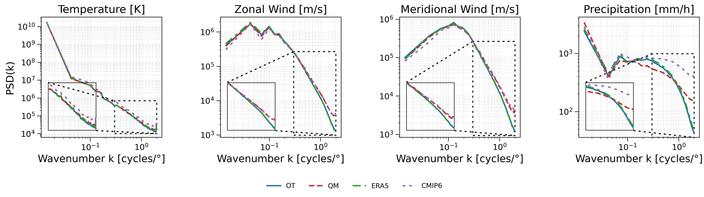
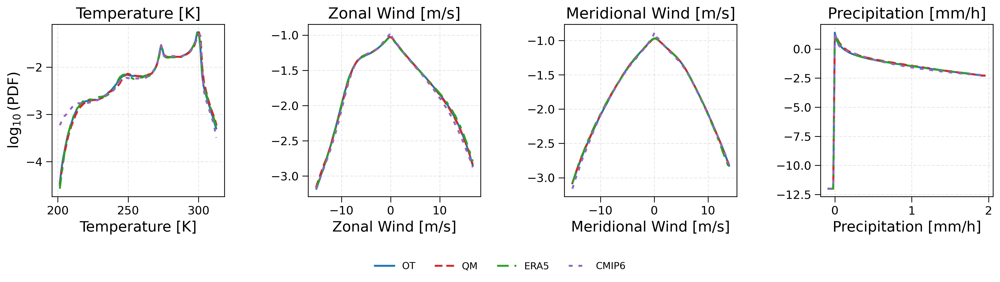
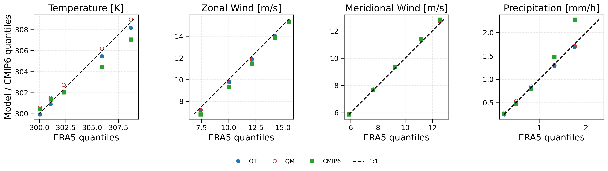
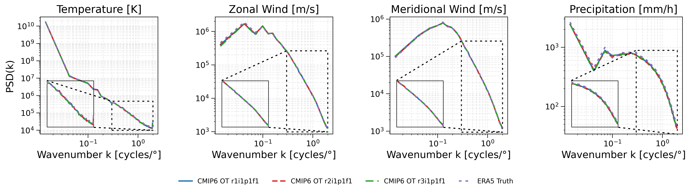
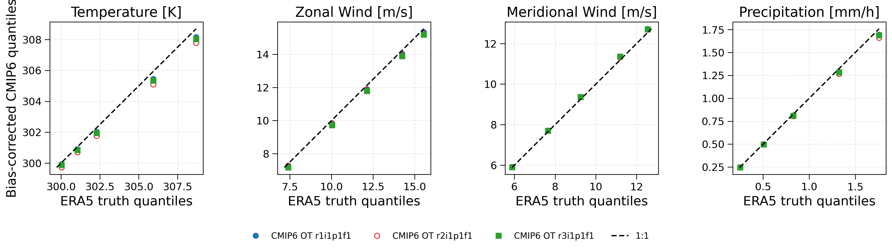
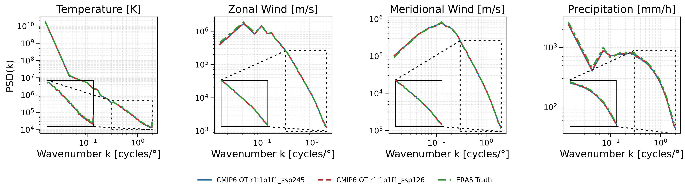
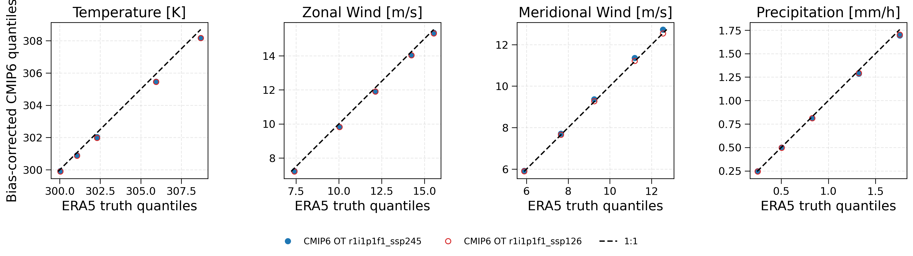

Bias-correction (AID-BC)
========================

Overview
--------

AID-BC is designed to reduce systematic biases in CMIP6 climate simulations
using ERA5 as the reference.

Two bias-correction approaches are considered:

- **Quantile Mapping (QM)** for univariate correction;
- **Optimal Transport (OT)** for joint multivariate correction.

The corrected fields can be evaluated directly at low resolution or used as
input to the IPSL-AID generative downscaling framework.

Data Preparation
----------------

Bias correction is performed on the native IPSL-CM6A-LR grid
(:math:`143 \times 144`). ERA5 is therefore preprocessed onto the same grid.

The workflow uses four variables:

- 2-m air temperature (``VAR_2T`` / ``tas``)
- 10-m zonal wind (``VAR_10U`` / ``uas``)
- 10-m meridional wind (``VAR_10V`` / ``vas``)
- precipitation (``VAR_TP`` / ``pr``)

ERA5 and CMIP6 must use compatible temporal sampling and physical units.
The fields are stored as yearly NetCDF files with four time steps per day.

Separate CMIP6 datasets are provided for training and application.

The ERA5-to-CMIP6 preprocessing procedure is described in the Core Concepts
section.

Model Configuration
-------------------

The correction is fitted independently for each month using ``split = month``.

For QM, each variable is corrected separately. For multivariate OT, the four
variables are corrected jointly.

The OT experiments use:

- ``epsilon = 1``
- ``num_iterations = 1000000``
- ``threshold = 0.1``
- ``batch_size = 16``
- ``dtype = float64``

The role of these parameters is described in the Core Concepts section.

Training
--------

The bias-correction transformation is calibrated from historical ERA5 and
CMIP6 data over **1980--2014**.

One correction is fitted for each month and subsequently reused during
inference.

Inference
---------

The fitted correction is applied to CMIP6 simulations for **2021**.

The experiments include different CMIP6 realizations and future scenarios
using the same trained correction.

The resulting bias-corrected fields are saved on the native CMIP6 grid as
yearly NetCDF files and can be evaluated against ERA5 or used as input to
IPSL-AID.

Results
-------

Bias-correction methods
~~~~~~~~~~~~~~~~~~~~~~~

The impact of bias correction is evaluated by comparing raw CMIP6,
Quantile Mapping (QM), Optimal Transport (OT), and ERA5 over 2021.

Descriptive statistics
^^^^^^^^^^^^^^^^^^^^^^

The table below summarizes the mean, standard deviation, minimum and maximum
values over the 2021 application period. Temperature is expressed in K, wind
components in m s\ :sup:`-1`, and precipitation in mm h\ :sup:`-1`.

.. list-table::
   :header-rows: 1
   :widths: 12 16 12 12 12 12

   * - Variable
     - Dataset
     - Mean
     - Std
     - Min
     - Max

   * - ``VAR_2T``
     - ERA5
     - 278.83
     - 21.35
     - 196.60
     - 324.24
   * -
     - CMIP6
     - 278.39
     - 22.20
     - 178.40
     - 322.03
   * -
     - QM
     - 279.19
     - 21.07
     - 193.87
     - 322.58
   * -
     - OT
     - 278.62
     - 21.20
     - 196.04
     - 324.76

   * - ``VAR_10U``
     - ERA5
     - -0.04
     - 5.47
     - -36.44
     - 27.04
   * -
     - CMIP6
     - -0.14
     - 5.22
     - -30.96
     - 33.25
   * -
     - QM
     - -0.07
     - 5.39
     - -34.65
     - 27.14
   * -
     - OT
     - -0.05
     - 5.41
     - -33.93
     - 27.16

   * - ``VAR_10V``
     - ERA5
     - 0.17
     - 4.59
     - -27.55
     - 26.57
   * -
     - CMIP6
     - 0.20
     - 4.54
     - -28.16
     - 30.12
   * -
     - QM
     - 0.19
     - 4.60
     - -30.16
     - 29.47
   * -
     - OT
     - 0.20
     - 4.60
     - -26.76
     - 31.55

   * - ``VAR_TP``
     - ERA5
     - 0.10
     - 0.27
     - 0.00
     - 13.17
   * -
     - CMIP6
     - 0.10
     - 0.37
     - 0.00
     - 23.97
   * -
     - QM
     - 0.11
     - 0.27
     - 0.00
     - 14.29
   * -
     - OT
     - 0.09
     - 0.26
     - 0.00
     - 13.65

Overall, both correction methods bring several first-order statistics closer
to ERA5.
For temperature, OT closely reproduces the ERA5 mean and range, while both
methods improve the variability compared with raw CMIP6. For the wind
components, the differences are relatively small, as CMIP6 is already close
to ERA5.

The largest change is observed for precipitation. Raw CMIP6 has a substantially
larger standard deviation and maximum value than ERA5. Both corrections reduce
this spread, with OT reproducing the ERA5 standard deviation and maximum more
closely.

Power spectral density
^^^^^^^^^^^^^^^^^^^^^^

The power spectral density (PSD) measures how spatial variance is distributed
across scales. Low wavenumbers represent large-scale structures, while high
wavenumbers correspond to finer spatial variability.

For temperature, the four spectra are very similar over most of the resolved
wavenumber range, with only small differences at the finest spatial scales.

The same pattern is observed for the zonal and meridional wind components.
At large and intermediate scales, QM and OT both follow ERA5 closely. At the
finest scales, however, OT remains better aligned with ERA5, while QM stays
closer to the uncorrected CMIP6 spectrum.

Precipitation shows the clearest differences between the methods. The raw
CMIP6 spectrum departs strongly from ERA5 at fine scales. Both corrections
modify this behaviour, but OT follows the ERA5 spectral decay more closely
than QM.

Overall, the main differences between QM and OT appear at the finest spatial
scales, especially for precipitation.

Probability density functions
^^^^^^^^^^^^^^^^^^^^^^^^^^^^^

The probability density functions compare the marginal distributions of ERA5,
raw CMIP6, QM-corrected CMIP6 and OT-corrected CMIP6. The vertical axis shows
the base-10 logarithm of the estimated probability density in order to make
differences in the distribution tails more visible.

For the two wind components, all four distributions are very similar, with only
small differences across the range.

For temperature, the main differences appear in the lower tail. Raw CMIP6
departs from ERA5 at low temperatures, while both QM and OT bring the
distribution closer to the reference.

For precipitation, the four distributions are also very similar over most of
the range, and the differences between CMIP6, QM, OT and ERA5 remain limited in
the PDF representation.

Quantile--quantile comparison
^^^^^^^^^^^^^^^^^^^^^^^^^^^^^

The quantile--quantile (QQ) plots compare selected upper quantiles against the
corresponding ERA5 values. The quantiles shown are 0.90, 0.95, 0.975, 0.99 and
0.995.

ERA5 quantiles are shown on the horizontal axis, while the corresponding
CMIP6, QM and OT quantiles are shown on the vertical axis. The dashed black
line represents the ideal 1:1 relationship.

For temperature, QM is very closely aligned with the 1:1 line across all
quantiles and is closer to the ERA5 reference than OT, especially for the
highest quantiles. This is expected, since QM directly corrects the marginal
quantiles of each variable.

The remaining OT underestimation may reflect its multivariate formulation,
which targets the joint distribution rather than an exact temperature marginal.
The use of a correction calibrated over 1980--2014 and applied to 2021 may
also contribute to this residual bias.

For the wind components, both QM and OT remain close to the ERA5 reference,
with only small differences between the methods and the raw CMIP6 data.

For precipitation, both correction methods reduce the deviation from ERA5
observed in raw CMIP6. QM is slightly closer to the 1:1 line for the first
two quantiles, while QM and OT give very similar results for the higher
quantiles.

Evaluation
----------

Two complementary analyses are considered to assess the robustness of the
bias-correction framework: robustness across CMIP6 realizations and sensitivity
to SSP scenarios.

Robustness across realizations
~~~~~~~~~~~~~~~~~~~~~~~~~~~~~~

The robustness of the bias correction is evaluated using three
IPSL-CM6A-LR realizations:

- ``r1i1p1f1``
- ``r2i1p1f1``
- ``r3i1p1f1``

Power spectral density
^^^^^^^^^^^^^^^^^^^^^^

The three realizations show very similar power spectra and remain closely
aligned with ERA5 across all variables.

Quantile--quantile comparison
^^^^^^^^^^^^^^^^^^^^^^^^^^^^^

The corrected distributions are consistent across the three realizations and
closely follow the ERA5 reference. A slight underestimation remains for
2-m air temperature.

Sensitivity to SSP scenarios
~~~~~~~~~~~~~~~~~~~~~~~~~~~~

The sensitivity of the bias correction to the forcing scenario is evaluated
for the ``r1i1p1f1`` realization using two scenarios:

- SSP1-2.6
- SSP2-4.5

Power spectral density
^^^^^^^^^^^^^^^^^^^^^^

The two bias-corrected scenarios show very similar power spectra and remain
closely aligned with ERA5 across all variables.

Quantile--quantile comparison
^^^^^^^^^^^^^^^^^^^^^^^^^^^^^

For 2021, the corrected distributions are highly consistent across both
scenarios and closely follow the ERA5 reference. A slight underestimation
remains for 2-m air temperature.
