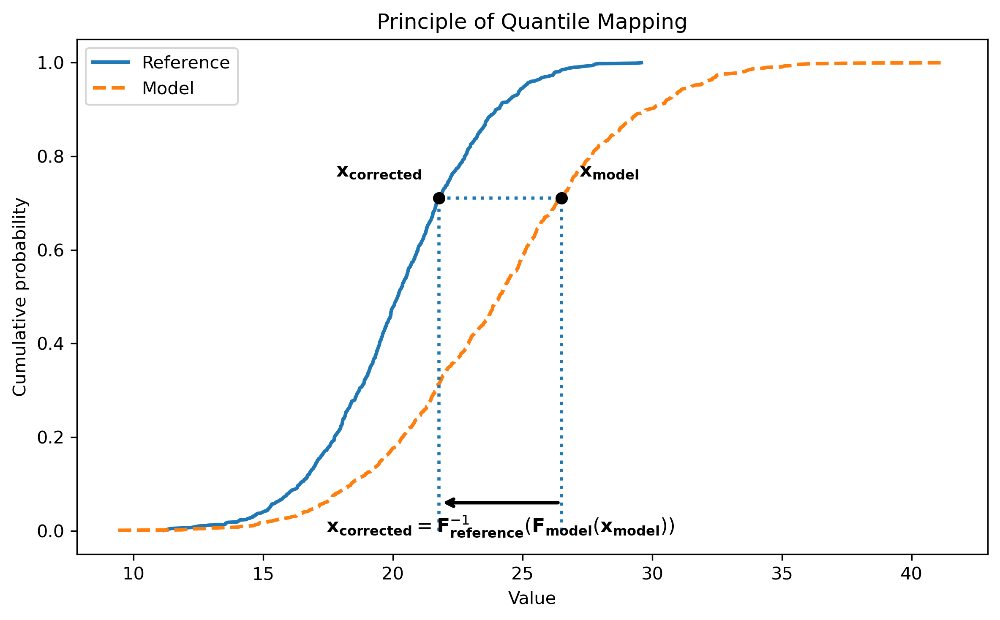

Bias Correction
===============

AID-BC provides two bias-correction methods to reduce systematic distributional
differences between CMIP6 climate model outputs and ERA5 reference data:

- **Quantile Mapping (QM)**, for univariate correction,
- **Optimal Transport (OT)**, for univariate or multivariate correction.

Both methods are fitted over a selected training period and then applied to a
CMIP6 application period. The corrected CMIP6 fields can subsequently be used
as large-scale inputs for AI-based downscaling experiments.

Bias correction is performed on the native CMIP6 grid. ERA5 data are therefore
either projected onto the CMIP6 grid during preprocessing or loaded from
previously prepared ERA5-on-CMIP6 files.

Quantile Mapping
----------------

Quantile Mapping corrects one climate variable at a time by matching the
distribution of biased CMIP6 data to the ERA5 reference distribution while
preserving the relative rank of the CMIP6 values.

For a CMIP6 value :math:`x_{CMIP6}`, the corresponding quantile in the CMIP6
training distribution is

.. math::

   q = F_{CMIP6}(x_{CMIP6})

and the corrected value is obtained from the ERA5 inverse cumulative
distribution function:

.. math::

   x_{corrected} = F^{-1}_{ERA5}(q)

or equivalently,

.. math::

   x_{corrected}
   = F^{-1}_{ERA5}\left(F_{CMIP6}(x_{CMIP6})\right)

The principle is illustrated below.

   Illustration of Quantile Mapping. A CMIP6 value is converted into a
   cumulative probability using the CMIP6 CDF, then mapped to the ERA5 value
   corresponding to the same probability.

In the current implementation, exactly one climate variable is corrected in a
Quantile Mapping experiment. Fields are reshaped from

.. code-block:: text

   (time, latitude, longitude)

to

.. code-block:: text

   (time, latitude * longitude)

before fitting.

AID-BC can fit either one global Quantile Mapping corrector using all training
samples or one independent corrector for each month.

Optimal Transport
-----------------

Optimal Transport can correct one or several climate variables jointly and can
therefore account for spatial and inter-variable dependencies that are not
explicitly represented by a variable-by-variable correction.

AID-BC treats each time step as a point in a feature space. The cost of
transporting a CMIP6 point :math:`x` to an ERA5 point :math:`y` is the squared
Euclidean distance:

.. math::

   c(x, y) = \|x - y\|^2

Instead of solving the unregularized transport problem directly, AID-BC uses
entropy-regularized Optimal Transport:

.. math::

   \min_{\pi \in \Pi(a, b)}
   \sum_{i,j} \pi_{ij} c(x_i, y_j)
   +
   \varepsilon
   \sum_{i,j} \pi_{ij}
   \left(\log \pi_{ij} - 1\right)

where ``a`` and ``b`` are uniform empirical weights and
:math:`\varepsilon` controls the strength of the entropic regularization.

The regularized problem is solved with the Sinkhorn algorithm in log space.
The iterations stop when the change in the dual potentials falls below a
convergence threshold or when the maximum number of iterations is reached.

After fitting, the ERA5-side dual potential is used to construct a smooth
transport function for new CMIP6 samples:

.. math::

   f_{\varepsilon}(x) =
   -\varepsilon \log
   \left(
      \sum_i
      \exp\left(
         \frac{
            g_{\varepsilon}(y_i) - c(x, y_i)
         }{\varepsilon}
      \right)
      b_i
   \right)

.. math::

   T(x) = x - \tfrac{1}{2} \nabla f_{\varepsilon}(x)

This allows new CMIP6 samples to be corrected without solving a new full
Sinkhorn problem for each sample.

Feature space construction
~~~~~~~~~~~~~~~~~~~~~~~~~~

ERA5 and CMIP6 training fields can be standardized using a shared per-feature
normalization. The same normalization parameters are used during application,
and corrected values are transformed back to their original physical scale.

For a single variable, each time step is flattened into a vector of length

.. code-block:: text

   latitude * longitude

For several jointly corrected variables, the flattened fields are concatenated
into a vector of length

.. code-block:: text

   n_variables * latitude * longitude

so that all variables and grid points are transported jointly.

Training and application
------------------------

Both Quantile Mapping and Optimal Transport use the same two-period workflow.

Training period
~~~~~~~~~~~~~~~

The training period is used to estimate the statistical relationship between
ERA5 and historical CMIP6 data.

Both datasets must share the same latitude-longitude grid. In the current
workflow, ERA5 is represented on the native CMIP6 grid.

Application period
~~~~~~~~~~~~~~~~~~

The application period contains the CMIP6 data to be corrected using the fitted
Quantile Mapping or Optimal Transport model.

It can correspond to:

- a historical period not used during training,
- a validation or test period,
- a future CMIP6 simulation period.

Corrected fields are reconstructed on the native CMIP6 grid and saved as yearly
NetCDF files.

Monthly splitting
-----------------

Both methods can use either:

- one global corrector fitted from all training samples,
- one independent corrector for each month.

Monthly splitting is especially useful for Optimal Transport because the
Sinkhorn problem involves a pairwise cost matrix of shape
``(n_x, n_y)``, where ``n_x`` and ``n_y`` are the numbers of CMIP6 and ERA5
training samples.

When the two sample counts are similar, memory and computational requirements
scale approximately quadratically with the number of training samples.
Splitting the training period by month therefore substantially reduces
the size of each transport problem.

Optimal Transport parameters
----------------------------

The Optimal Transport solver is controlled by the following parameters:

``epsilon``
   Strength of the entropic regularization. Larger values produce a smoother
   transport problem, while smaller values generally preserve more variability
   but are harder to optimize.

``num_iterations``
   Maximum number of Sinkhorn iterations.

``threshold``
   Convergence threshold applied to changes in the dual potentials.

``dtype``
   Floating-point precision used by JAX (``float32`` or ``float64``).

``batch_size``
   Number of time steps transported together during application to control
   memory usage.

Workflow
--------

The AID-BC workflow consists of an optional preprocessing step followed by
bias correction using either Quantile Mapping or Optimal Transport.

1. Precompute ERA5 on the CMIP6 grid
~~~~~~~~~~~~~~~~~~~~~~~~~~~~~~~~~~~~

``AID_BC.preprocess`` resizes one ERA5 variable onto the native CMIP6 grid and
writes one compressed NetCDF file per year.

Run this step once for each ERA5 variable and CMIP6 grid combination.

Example:

.. code-block:: bash

   python -m AID_BC.preprocess \
     --era5_root /path/to/ERA5/data_6hourly_t2m \
     --cmip6_root /path/to/CMIP6_historical/data_6hourly_tas \
     --variable VAR_2T \
     --start_year 1980 \
     --end_year 2014 \
     --output_dir /path/to/ERA5_on_CMIP6/data_6hourly_t2m

The output directory contains one file per year together with a
``metadata.json`` file describing the preprocessing configuration:

.. code-block:: text

   data_6hourly_t2m/
   ├── samples_1980.nc
   ├── samples_1981.nc
   ├── ...
   ├── samples_2014.nc
   └── metadata.json

For multivariate Optimal Transport experiments, preprocessing must be performed
once for each variable.

2. Run Quantile Mapping
~~~~~~~~~~~~~~~~~~~~~~~

Quantile Mapping accepts exactly one variable.

Example:

.. code-block:: bash

   python -m AID_BC.main \
     --method qm \
     --split month \
     --train_start 1980 \
     --train_end 2014 \
     --apply_start 2021 \
     --apply_end 2021 \
     --variables VAR_2T \
     --era5_on_cmip6_root \
       VAR_2T=/path/to/ERA5_on_CMIP6/data_6hourly_t2m \
     --cmip6_train_root \
       VAR_2T=/path/to/CMIP6_historical/data_6hourly_tas \
     --cmip6_apply_root \
       VAR_2T=/path/to/CMIP6_future/data_6hourly_tas \
     --output_dir \
       VAR_2T=data/CMIP6_QM/data_6hourly_tas_corrected

3. Run Optimal Transport
~~~~~~~~~~~~~~~~~~~~~~~~

Optimal Transport can correct one variable or several variables jointly.

Example:

.. code-block:: bash

   python -m AID_BC.main \
     --method ot \
     --split month \
     --train_start 1980 \
     --train_end 2014 \
     --apply_start 2021 \
     --apply_end 2021 \
     --variables VAR_2T VAR_10U VAR_10V VAR_TP \
     --era5_on_cmip6_root \
       VAR_2T=/path/to/ERA5_on_CMIP6/data_6hourly_t2m \
       VAR_10U=/path/to/ERA5_on_CMIP6/data_6hourly_u10 \
       VAR_10V=/path/to/ERA5_on_CMIP6/data_6hourly_v10 \
       VAR_TP=/path/to/ERA5_on_CMIP6/data_6hourly_tp_3hmean \
     --cmip6_train_root \
       VAR_2T=/path/to/CMIP6_historical/data_6hourly_tas \
       VAR_10U=/path/to/CMIP6_historical/data_6hourly_uas \
       VAR_10V=/path/to/CMIP6_historical/data_6hourly_vas \
       VAR_TP=/path/to/CMIP6_historical/data_6hourly_pr \
     --cmip6_apply_root \
       VAR_2T=/path/to/CMIP6_future/data_6hourly_tas \
       VAR_10U=/path/to/CMIP6_future/data_6hourly_uas \
       VAR_10V=/path/to/CMIP6_future/data_6hourly_vas \
       VAR_TP=/path/to/CMIP6_future/data_6hourly_pr \
     --output_dir \
       VAR_2T=data/CMIP6_OT/data_6hourly_tas_corrected \
       VAR_10U=data/CMIP6_OT/data_6hourly_uas_corrected \
       VAR_10V=data/CMIP6_OT/data_6hourly_vas_corrected \
       VAR_TP=data/CMIP6_OT/data_6hourly_pr_corrected \
     --ot_epsilon 1 \
     --ot_num_iterations 1000000 \
     --ot_threshold 0.1 \
     --ot_batch_size 16 \
     --ot_dtype float64

The Optimal Transport parameters may need to be adjusted depending on the
training period, sample size, variables, normalization, and available
computational resources.

Limitations
-----------

- Quantile Mapping is univariate and corrects only the marginal distribution
  of one climate variable at a time. It does not explicitly preserve
  dependencies between several climate variables.

- Optimal Transport is more computationally demanding. For ``n_x`` CMIP6
  samples and ``n_y`` ERA5 samples, the dominant pairwise matrices have shape
  ``(n_x, n_y)``, and memory usage scales as :math:`O(n_x n_y)`, or
  approximately :math:`O(N^2)` when the two sample counts are similar.

- Entropic regularization in Optimal Transport introduces smoothing. Large
  values of ``epsilon`` can reduce variance and extreme values.

- Small values of ``epsilon`` can make Sinkhorn convergence slower and more
  difficult.

- Both methods assume that the statistical relationship estimated during the
  training period remains applicable during the application period.

References
----------

[1] Pooladian, Aram-Alexandre, and Niles-Weed, Jonathan.
"Entropic estimation of optimal transport maps."
arXiv preprint arXiv:2109.12004 (2021).
