Generative Downscaling (IPSL-AID)
=================================

Overview
--------

IPSL-AID is a generative climate downscaling framework designed to reconstruct
high-resolution atmospheric fields from coarse-resolution inputs.

The framework uses a conditional diffusion model to generate fine-scale spatial
variability while retaining the large-scale information in the conditioning
fields.

The model is trained using ERA5 data and can be applied to climate simulations
from CMIP6, HighResMIP, and other climate models, with or without prior bias
correction using AID-BC.

Data Preparation
----------------

The experiment uses ERA5 reanalysis at :math:`0.25^\circ` resolution with four
atmospheric variables:

- 2-m air temperature (``VAR_2T``)
- 10-m zonal wind (``VAR_10U``)
- 10-m meridional wind (``VAR_10V``)
- precipitation (``VAR_TP``)

Four time steps per day are randomly selected during training.

Coarse-upsampled (CU) inputs are constructed from the high-resolution (HR)
ERA5 reference over the global domain. The HR fields are first downsampled
from :math:`721 \times 1440` to the native CMIP6 grid
(:math:`143 \times 144`) and then upsampled back to the ERA5 grid
(:math:`721 \times 1440`) using bilinear interpolation in both steps.

The target is the fine-scale residual:

.. math::

   R = y^{\mathrm{HR}} - y^{\mathrm{CU}}.

The model is conditioned on CU atmospheric fields, geographical information
(latitude, longitude, topography and land-sea mask), and temporal embeddings
representing the day of year and hour of day.

Model Configuration
-------------------

The model is based on the Elucidating Diffusion Models (EDM) framework with
an ADM U-Net architecture.

The network configuration includes:

- ``model_channels = 128``
- ``channel_mult = (1, 2, 3, 4)``
- ``num_blocks = 2``
- ``attn_resolutions = (32, 16, 8)``
- ``dropout = 0.10``
- ``dtype = fp32``

The four atmospheric variables are normalized before training using standard
normalization for temperature and wind components, and log1p followed by
standard normalization for precipitation.

The diffusion model uses four input channels for the atmospheric residuals
and eight conditioning channels combining the coarse-upsampled fields,
spatial coordinates, topography and land-sea mask.

The EDM sampling configuration uses:

- ``num_steps = 10``
- ``sigma_min = 0.002``
- ``sigma_max = 80``
- ``rho = 7``
- ``solver = heun``
- ``s_churn = 40``

The role of these parameters is described in the Core Concepts section.

Training
--------

The model is trained using ERA5 data over **2015--2019**, with **2020**
reserved for validation.

Training is performed on randomly sampled spatial patches of
:math:`144 \times 360` grid points over the global domain.

The training configuration uses:

- ``num_epochs = 10``
- ``learning_rate = 0.0001``
- ``batch_size = 70``
- ``sbatch = 12``
- ``tbatch = 1800``
- ``epsilon = 0.02``
- ``beta = 1.0``
- ``margin = 8``

Inference
---------

The trained model is applied to ERA5, CMIP6 and HighResMIP datasets using
fixed time steps: **2021** for ERA5 and CMIP6, and **2013** for HighResMIP.

For ERA5 and HighResMIP, the high-resolution fields are downsampled to
:math:`143 \times 144` and then upsampled back to the ERA5 grid using
bilinear interpolation. Both datasets are evaluated against their own
high-resolution reference fields.

For raw and AID-BC-corrected CMIP6, the fields are already available on
the native coarse grid (:math:`143 \times 144`) and therefore only require
bilinear upsampling to the ERA5 grid (:math:`721 \times 1440`).

The generated residuals are added to the upsampled inputs to reconstruct
the high-resolution atmospheric fields.

Results
-------

ERA5
~~~~

The downscaling performance is evaluated on ERA5 data for **2021** by
comparing the IPSL-AID outputs with the ERA5 high-resolution reference over
the global domain.

Validation metrics
^^^^^^^^^^^^^^^^^^

The table below summarizes the validation metrics for the four atmospheric
variables. Temperature is expressed in K, wind components in m s\ :sup:`-1`,
and precipitation in mm h\ :sup:`-1`.

.. list-table::
   :header-rows: 1
   :widths: 14 10 10 10 10 12 8 8

   * - Variable
     - MAE
     - NMAE
     - RMSE
     - R\ :sup:`2`
     - Pearson
     - KL
     - CRPS

   * - ``VAR_2T``
     - 0.325
     - 0.001
     - 0.546
     - 0.999
     - 1.000
     - 0.000
     - 0.172

   * - ``VAR_10U``
     - 0.357
     - 0.077
     - 0.579
     - 0.990
     - 0.995
     - 0.000
     - 0.202

   * - ``VAR_10V``
     - 0.347
     - 0.090
     - 0.565
     - 0.987
     - 0.993
     - 0.000
     - 0.188

   * - ``VAR_TP``
     - 0.041
     - 0.435
     - 0.193
     - 0.692
     - 0.848
     - 0.001
     - 0.024

Overall, the model shows very good agreement with ERA5 for temperature and
wind fields. The best performance is obtained for 2-m air temperature, with
near-perfect correlation and very small errors. The two wind components are
also well reproduced, with high correlation and low RMSE values.

Precipitation remains more challenging, with lower correlation and R\ :sup:`2` values
than the other variables. Nevertheless, the model captures a substantial
part of its variability.

Spatial error patterns
^^^^^^^^^^^^^^^^^^^^^^

The spatial distribution of the mean absolute error is shown below.

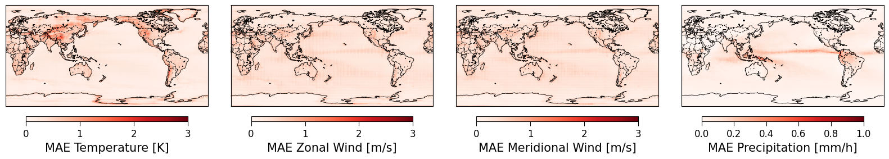

The MAE remains low across most of the global domain for all four variables.
Larger errors are mainly observed at high northern latitudes for temperature
and over continental regions for the wind components. Precipitation errors
are more concentrated in tropical regions, particularly along the
equatorial belt.

Probability density functions
^^^^^^^^^^^^^^^^^^^^^^^^^^^^^

The probability density functions compare the marginal distributions of the
ERA5 reference and IPSL-AID outputs for the four atmospheric variables.

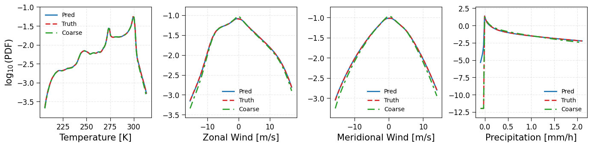

The predicted distributions closely follow ERA5 for all four variables,
with nearly overlapping curves for temperature and both wind components,
including the distribution tails. Small differences remain for precipitation
at higher intensities.

Quantile--quantile comparison
^^^^^^^^^^^^^^^^^^^^^^^^^^^^^

The quantile--quantile (QQ) plots compare the IPSL-AID distributions against
the ERA5 reference, with particular attention to the upper quantiles.

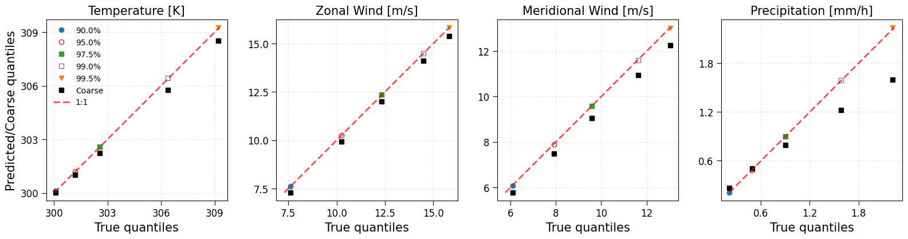

The predicted upper quantiles lie close to the 1:1 line for all four
variables. Compared with the coarse inputs, IPSL-AID generally provides
a better agreement with the reference, particularly at the highest quantiles.

Power spectral density
^^^^^^^^^^^^^^^^^^^^^^

The power spectral density (PSD) is used to evaluate how well the generated
fields reproduce the spatial variability of ERA5 across different scales.

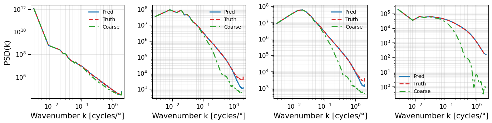

The predicted spectra closely match ERA5 for temperature and precipitation.
For both wind components, they also agree well with ERA5, except at the
highest wavenumbers, where some differences remain. Overall, IPSL-AID
recovers much of the fine-scale variability missing from the coarse inputs.

HighResMIP
~~~~~~~~~~

The downscaling performance is evaluated on HighResMIP data for **2013** by
comparing the IPSL-AID outputs with the HighResMIP high-resolution reference
over the global domain.

Validation metrics
^^^^^^^^^^^^^^^^^^

The table below summarizes the validation metrics for the four atmospheric
variables. Temperature is expressed in K, wind components in m s\ :sup:`-1`,
and precipitation in mm h\ :sup:`-1`.

.. list-table::
   :header-rows: 1
   :widths: 14 10 10 10 10 12 8 8

   * - Variable
     - MAE
     - NMAE
     - RMSE
     - R\ :sup:`2`
     - Pearson
     - KL
     - CRPS

   * - ``VAR_2T``
     - 0.527
     - 0.002
     - 0.950
     - 0.998
     - 0.999
     - 0.001
     - 0.300

   * - ``VAR_10U``
     - 0.577
     - 0.135
     - 0.868
     - 0.975
     - 0.987
     - 0.000
     - 0.374

   * - ``VAR_10V``
     - 0.564
     - 0.153
     - 0.857
     - 0.967
     - 0.984
     - 0.000
     - 0.360

   * - ``VAR_TP``
     - 0.055
     - 0.557
     - 0.284
     - 0.627
     - 0.803
     - 0.002
     - 0.032

Overall, the model shows good agreement with the HighResMIP reference,
particularly for temperature and wind components. The errors are higher
than those obtained with ERA5 across all four variables. This may be
partly explained by the fact that the model was trained on ERA5 and is
applied here to a different climate dataset.

Probability density functions
^^^^^^^^^^^^^^^^^^^^^^^^^^^^^

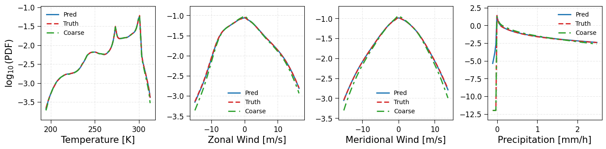

The predicted distributions remain close to the HighResMIP reference for all
four variables. The agreement is very good for temperature and both wind
components, with only small differences in the tails. For precipitation,
the predicted distribution also follows the reference well over most of the
range.

Quantile--quantile comparison
^^^^^^^^^^^^^^^^^^^^^^^^^^^^^

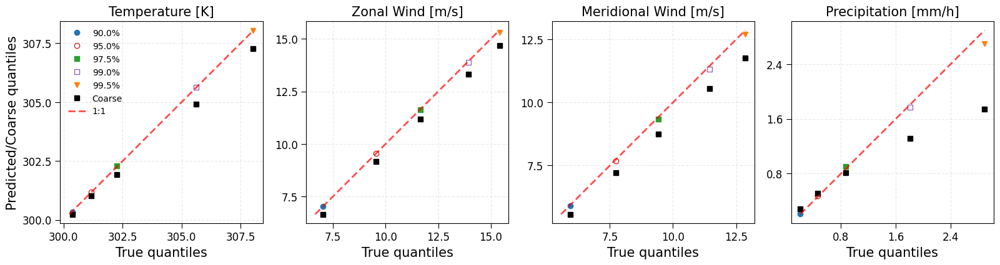

The predicted upper quantiles closely follow the 1:1 line for all four
variables. Compared with the coarse inputs, IPSL-AID better reproduces
the highest quantiles, with the clearest improvement for precipitation.

Power spectral density
^^^^^^^^^^^^^^^^^^^^^^

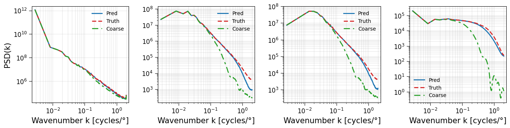

The predicted spectra closely match the HighResMIP reference for temperature.
For both wind components and precipitation, the agreement is good at large
and intermediate scales, but some underestimation appears at the highest
wavenumbers. Overall, IPSL-AID recovers much of the fine-scale variability
missing from the coarse inputs.

Comparison with ERA5
^^^^^^^^^^^^^^^^^^^^

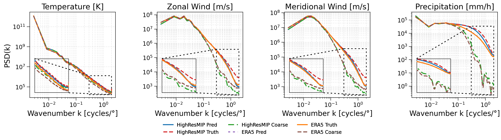

The comparison with ERA5 helps explain the differences observed in the
HighResMIP spectra. For both wind components, the predicted spectra follow
ERA5 more closely at the highest wavenumbers, suggesting that the model
tends to reproduce ERA5-like fine-scale variability.

For precipitation, the predicted HighResMIP spectrum lies between the
HighResMIP and ERA5 references, showing a different behaviour.

CMIP6 IPSL
~~~~~~~~~~

The downscaling results are evaluated for the IPSL-CM6A-LR simulation
``r1i1p1f1`` under the SSP2-4.5 scenario in **2021**, using CMIP6 fields
bias-corrected with Optimal Transport (OT) as inputs.

Unlike ERA5 and HighResMIP, CMIP6 does not provide a corresponding
high-resolution reference. The evaluation therefore focuses on comparing
the statistical distributions and spatial variability of the downscaled
fields with ERA5.

Quantile--quantile comparison
^^^^^^^^^^^^^^^^^^^^^^^^^^^^^

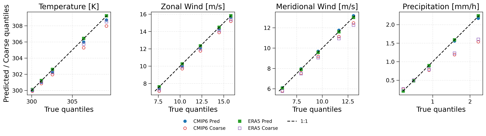

The QQ plots compare the ERA5 reference, ERA5 and CMIP6 predictions,
and their corresponding coarse inputs.

The downscaled CMIP6 quantiles are closer to the 1:1 line than the coarse
inputs for all four variables. A slight underestimation remains for
temperature, particularly at the highest quantiles, while both wind
components and precipitation show good agreement with ERA5.

Power spectral density
^^^^^^^^^^^^^^^^^^^^^^

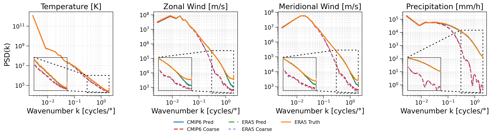

The PSD comparison includes the ERA5 reference, ERA5 and CMIP6 predictions,
and their corresponding coarse inputs.

The downscaled CMIP6 spectra closely match ERA5 for temperature and
precipitation. For both wind components, the CMIP6 predictions closely
follow the ERA5 predictions, with some differences from the ERA5 reference
at the highest wavenumbers. Overall, IPSL-AID recovers much of the
fine-scale variability missing from the coarse CMIP6 inputs.

Comparison of bias-correction methods
^^^^^^^^^^^^^^^^^^^^^^^^^^^^^^^^^^^^^

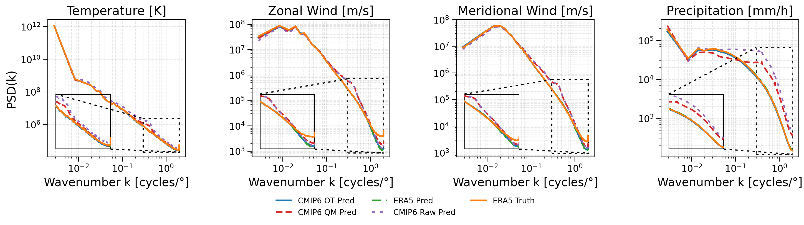

The downscaled CMIP6 spectra obtained with OT are generally closer to ERA5
than those obtained with QM or raw CMIP6, particularly at high wavenumbers
for the wind components and precipitation. This agrees with the AID-BC
results, where OT better reproduces the fine-scale variability of ERA5.
